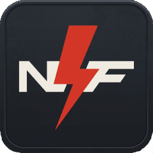
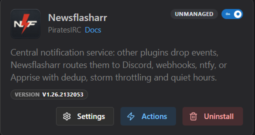
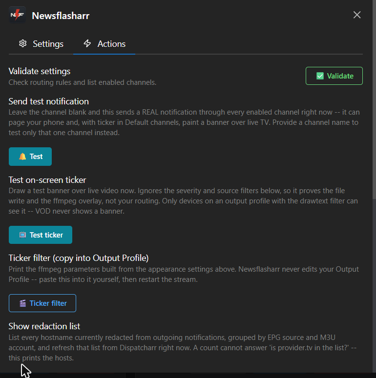

<!-- The logo sits ABOVE the title, not floated beside it. GitHub draws a
     full-width rule under a level-1 heading, and align="right" floats the
     image into that rule, so the line appeared to run through the logo. -->

  

<h1 align="center">Newsflasharr</h1>

> [!TIP]
> **New to Dispatcharr plugins?** Start with the **[Dispatcharr Plugin Workflow guide](https://piratesirc.github.io/Dispatcharr-Plugin-Workflow/)**.
> It explains what each plugin and tool does, where they overlap, and what order to use them in.

Central notification service for Dispatcharr plugins. One plugin
owns all delivery: other plugins (Sentinelarr, Dustarr, Stream-Mapparr, …)
drop lightweight JSON events into a file spool; Newsflasharr routes them to
any of six destinations (Discord, a generic webhook, ntfy, Apprise, email,
and an on-screen banner over live video) with deduplication, storm throttling,
quiet hours, and retry. Configured once, in one place, instead of every plugin
re-inventing its own webhook code.

This page covers what the plugin is and what it does. Setting it up lives in
the **[user guide](docs/USER-GUIDE.md)**, and sending events to it from your
own plugin lives in the **[caller API](docs/API.md)**. The full list is under
[Documentation](#documentation) below.

## What it does

- **A calling plugin makes one call and is finished.** `notify(...)` writes a
  small file and returns. It never blocks and never raises, so a caller is
  unaffected even when Newsflasharr is not running.
- **Repeats collapse instead of flooding you.** The same alert arriving
  repeatedly becomes one message plus a summary when the window closes. An
  alert that gets worse breaks the window and is sent at once, so a warning
  can never swallow the critical that follows it.
- **Quiet hours, an hourly cap, and per-channel retry** are configured once
  here rather than separately in every plugin.
- **Your provider hostnames are removed from outgoing messages**, using the
  EPG sources and accounts Dispatcharr already holds.
- **It is read-only on Dispatcharr.** It writes nothing outside its own
  `/data/newsflasharr/` directory, and it never creates or edits an Output
  Profile, a channel or a stream.
- **Delivery is at-least-once per channel.** A duplicate is possible after a
  crash. That is a deliberate tradeoff, described in the
  [caller API](docs/API.md).

## What it looks like

The plugin card in Dispatcharr, under Plugins then My Plugins:

The Actions tab. Every action writes its complete output to a file, because
the pop-up notification holds only about 280 characters:

The settings screens appear in the [user guide](docs/USER-GUIDE.md), beside
the instructions for filling them in.

## Documentation

| Page | For |
|---|---|
| **[User guide](docs/USER-GUIDE.md)** | Setting up channels, routing rules, quiet hours, redaction, the on-screen ticker, and the troubleshooting ladder. |
| **[Caller API](docs/API.md)** | The contract another plugin codes against to send events. |
| **[Developer guide](docs/DEVELOPER-GUIDE.md)** | How the plugin is put together, how to run the tests, and how to contribute. |
| **[Changelog](docs/CHANGELOG.md)** | What changed between versions. |

## Disclaimer

**Newsflasharr provides no television content of any kind.** It supplies no
channels, no playlists, no streams, no electronic programme guide data and no
provider accounts, and it contains no list of where to obtain any of those. It
is a notification service: it reads status information that Dispatcharr already
holds about the sources **you** configured, and it sends short messages about
that status to destinations **you** configured.

The plugin never contacts a media provider. It never opens, fetches, decodes,
records, restreams or redistributes any stream. The only outbound connections
it makes are to the notification destinations you enter yourself, such as a
Discord webhook, an ntfy topic, an Apprise gateway or your own mail server.

**You are responsible for what you connect Dispatcharr to.** Whether a
particular provider, subscription, playlist or stream is lawful for you to use
depends on your agreement with that provider and on the law where you live. Use
only sources you are authorised to use. Nothing in this project is intended to
enable, encourage or assist access to content you have no right to access.

All product names, channel names, trademarks and registered trademarks
mentioned in this project or appearing in its examples are the property of their
respective owners. This project is an independent, community-built plugin. It is
not affiliated with, endorsed by, or sponsored by any television network,
broadcaster, streaming service or IPTV provider, and it is not affiliated with
the Dispatcharr project beyond being a plugin written for it.

The software is provided as-is, without warranty of any kind, as set out in the
licence below. This section describes the design of the software and the
author's intent. It is not legal advice. If you need to know whether your own
use is lawful, ask someone qualified in your jurisdiction.

## License

MIT. See [`LICENSE`](LICENSE).

