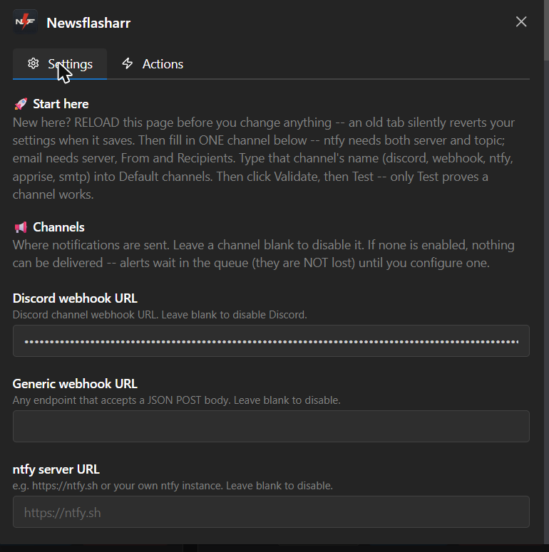
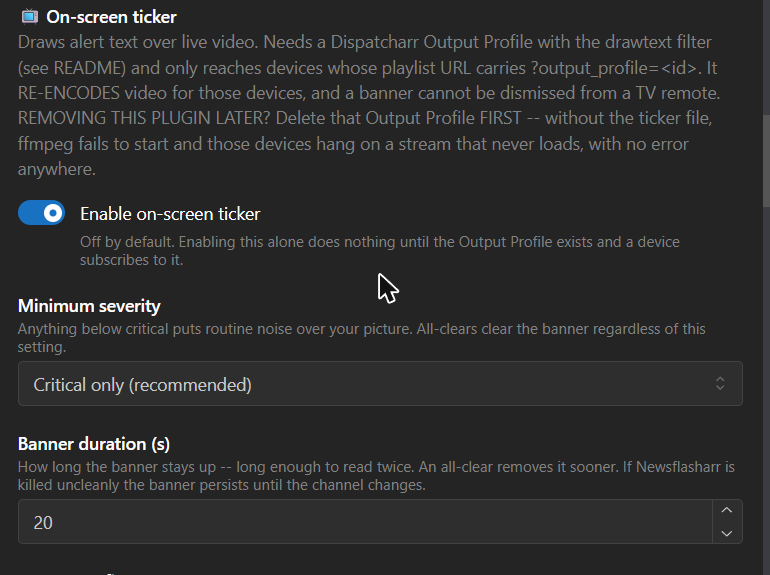

# Newsflasharr user guide

Everything needed to configure and run Newsflasharr, in the order you will need
it. Newer to the plugin? Read [the project front page](../README.md) first for
what it does and how to install it.

| Also available | |
|---|---|
| [Documentation index](README.md) | every page in one list |
| [Caller API](API.md) | for developers whose plugin sends events |
| [Developer guide](DEVELOPER-GUIDE.md) | architecture, tests, contributing |
| [Changelog](CHANGELOG.md) | what changed between versions |

Screenshots of the settings pages are on the front page.

> **A note on `source` names.** The examples below use `sentinelarr` and
> `dustarr` as the calling plugins. A `source` string is simply whatever the
> calling plugin passes, so use whatever your own callers actually send. If a
> caller is ever renamed, keep routing rules for **both** the old and the new
> name until every caller has been updated, so the rename leaves no window in
> which events go unrouted.

---

## Two names for the same things

The settings page and the action buttons deliberately avoid internal jargon, but the
**file paths, ledger entries and JSON keys keep the original names**: they are an interface
other tools read, and renaming them would be a silent breaking change for a cosmetic gain.
So the same thing has two names depending on where you are looking. This table is the map.

| The UI says | Paths / ledger / JSON say | What it is |
| --- | --- | --- |
| queue, queue depth | `spool`, `/data/newsflasharr/spool/`, `spool_depth` | Events written by a calling plugin, waiting to be claimed |
| repeat window, active repeat windows | `dedup`, `dedup_key`, `dedup_active` | The window during which the same alert collapses into one send |
| one summary message | `digest` | The message that carries what was collapsed or held |

The rest of this document is written for someone reading logs and file paths, so it uses the
**right-hand** column. The settings page uses the left.

## Channel setup

All channel fields live in the plugin's settings screen. Any subset can be
enabled; leaving a field blank disables that channel.



Credential fields are masked once saved, which is why a filled Discord field
shows as dots rather than the URL you pasted.

- **Discord**: `discord_webhook_url`. Create a webhook on the target channel
  (Discord: Channel Settings → Integrations → Webhooks → New Webhook → Copy
  URL) and paste the URL in. It is a bearer credential, so the field is
  password-masked in the UI and is never echoed back in status/ledger output.
- **Generic webhook**: `webhook_url`. Any endpoint that accepts a JSON POST
  body (`plugin`, `event`, `severity`, `kind`, `title`, `body`, `url`, `ts`).
  Useful for a home-grown receiver, Zapier/n8n/Home Assistant webhook
  triggers, etc.
- **ntfy**: `ntfy_server` (e.g. `https://ntfy.sh` or your own self-hosted
  instance), `ntfy_topic` (the topic name you subscribe to in the ntfy app),
  and optionally `ntfy_token` if the topic is access-controlled. Newsflasharr
  publishes via ntfy's JSON POST format (not raw headers) specifically
  because titles can contain non-Latin glyphs that would break an HTTP
  header.
- **Apprise**: `apprise_url`, pointed at an
  [apprise-api](https://github.com/caronc/apprise-api) container's
  `/notify/<key>` endpoint. This fans out to Apprise's ~110-service long tail
  (Signal, Telegram, email, Pushover, …) without Newsflasharr needing to know
  about any of them. Run `apprise-api` as its own small container, configure
  its `<key>`'s target services inside Apprise itself, then point
  `apprise_url` at `http://<apprise-api-host>:<port>/notify/<key>`.
- **Email (SMTP)**: `smtp_server`, `smtp_security`, `smtp_username`,
  `smtp_password`, `smtp_from`, `smtp_to`. Native and stdlib-only; **it does
  not replace Apprise**, which remains a perfectly good route to email if you
  already run an apprise-api container. Sends `multipart/alternative` (a plain
  part and an HTML part), so it renders properly in any client.

  `smtp_server` takes `host` or `host:port` (default 587; bracket IPv6
  literals). `smtp_security` defaults to `auto`, which infers `ssl` for port
  465 and `starttls` otherwise. **Validate settings prints what it resolved
  to**, because the wrong mode hangs rather than erroring, which is the worst
  symptom to debug. Leave `smtp_username` blank for an unauthenticated LAN
  relay; email counts as enabled only when a server, a valid recipient, and a
  From address are all present.

  Things that will cost you time if nobody warns you:

  - **Gmail, Outlook and Yahoo reject your normal account password** over
    SMTP. You need an **app password**: enable 2-Step Verification, generate a
    16-character app password, and paste *that* into `smtp_password`.
  - **Outbound port 25 is blocked by most residential ISPs.** Use 587 or 465.
  - **A `From:` at a domain you do not control** gets junked or rejected
    outright. Leaving `smtp_from` blank falls back to the username, which is
    the safe choice.
  - **Gmail relays cap around 500 messages/day.** `max_sends_per_hour`
    defaults to 20, which is 480 per day at worst. That is close enough to matter.
  - **TLS certificates are always verified and there is no opt-out setting.**
    A verification toggle gets switched off the first time a cert expires and
    never switched back. If you need a self-signed internal relay, that is
    what `smtp_security: none` on a trusted segment is for, and note that
    `none` combined with a username is refused outright, because it would put
    your password on the wire in base64 on every single send.
  - **"Sent" is not "delivered."** See below.

### Email is the one channel where a green ledger entry can be a lie

Every other channel fails loudly with an HTTP status code. SMTP does not: a
`250` from the mail server means it **accepted the message for relay**, and
says nothing about spam foldering, greylisting, or a recipient-side filter. So
a `delivered` row in `notifications.jsonl` can correspond to a notification you
never saw.

Confirm the first send by looking in the **inbox and the spam folder**. Do not
treat the ledger as proof for this channel the way you reasonably can for
Discord or ntfy.

One consequence worth planning around: a stalled mail server delays the
collector tick, and that tick is the single leader thread for **every**
channel. A hung SMTP server therefore slows Discord and ntfy too. The timeout
is 5 s and a failed connect skips SMTP for the rest of that tick, which bounds
it, but it is why email should not be your only channel for anything urgent.

## Sending a report as an attachment

A plugin that produces a scheduled artefact (dustarr's HTML usage report,
for example) can have Newsflasharr email it as a real attachment instead of
just linking to it. This is **smtp-only**: there is no attachment concept on
Discord, ntfy, webhook or Apprise.

Caller side, pass both `url=` and `attachment=`:

```python
notify(source="dustarr", title="Weekly channel-usage report",
       body="See attached, or the link below.",
       url="http://192.168.1.50:9191/logos/dustarr/report-20260720-135050.html",
       attachment="/data/dustarr/report-20260720-135050.html")
```

- **`attachment` must be an immutable, timestamped path, never the
  live/rewritten file** (e.g. never the plain `report.html` a scheduler
  overwrites in place). The file is re-read from disk on **every** send
  attempt, including retries, so if the path points at something that gets
  rewritten, a retry an hour later attaches whatever happens to be there at
  that moment, not what was there when the report actually ran. Point at a
  dated snapshot the producer never touches again.
- Send the `url` too, alongside the attachment. It is the fallback if a mail
  gateway strips the attachment, and it is the only copy that survives if the
  recipient is off-LAN and cannot reach the snapshot host.
- **Route it to smtp only.** Reports are noisy and low-urgency; carve them out
  of your normal channels with an `exclusive` rule so they do not also land on
  Discord/ntfy:

  ```json
  [{"match": {"source": "dustarr"}, "channels": ["smtp"], "exclusive": true}]
  ```

  Routing a report event to a non-smtp channel is harmless: it simply delivers
  the ordinary notification (with the link in the body) and no file, since
  only smtp knows what to do with `attachment`.
- Allowed extensions are **`.html`, `.htm`, `.csv`** only, capped at **1 MB**.
  A file that fails either check does not lose the whole email: it still
  sends with the link, minus the file, and the reason is ledgered
  (`attachment_missing`, `attachment_rejected`, `attachment_too_large`).
- **The file is attached VERBATIM and is NOT redacted.** Every other string
  Newsflasharr touches gets `redact()`/`redact_hosts()` treatment; the
  attachment bytes do not, because they are a caller-supplied file, not wire
  text, and no regex can safely rewrite an arbitrary HTML/CSV document without
  risking corruption. **Never point `attachment` at anything that could
  contain a credential, a raw stream URL, or anything else you would not put
  in a public log.**
- A report event **bypasses quiet hours and the hourly cap**, so it is never
  held. A held event becomes a digest line and loses its file entirely, and a
  report queued past `max_event_age_h` just expires; bypassing sidesteps both
  without needing any change to the digest engine. Any plugin passing
  `attachment` gets this bypass automatically. It is not separately
  configurable.
- Set **`report_expect_days`** (blank = off) to the cadence you expect a
  report on. Show Status then turns red if none arrives in time, which is the
  only way to notice a report that has silently stopped, since nothing about a
  missing scheduled call leaves any other trace. It compares against
  `last_attachment_delivered_ts`, which is stamped **only** on a real
  smtp-send that actually included the file (a link-only delivery, e.g. one
  misrouted to a non-smtp channel, does not stamp it and would correctly show
  as overdue). This is a single global check: it can tell you that AN
  attachment email went out recently, but not which caller sent it, so one
  loud caller's reports keep it green while a quiet caller's reports stop
  arriving unnoticed.
- To watch each caller separately, set **`report_expect`** to one entry per
  scheduled report, written as `source/event=days` and separated by commas
  or newlines, for example `sentinelarr/weekly_report=7,
  dustarr/usage_report=1`. Omitting `=days` on an entry falls back to
  `report_expect_days` as its cadence. Leaving `report_expect` blank keeps
  the global check above exactly as it was. Once `report_expect` holds any
  entries, the global check retires and each entry is reported on its own
  line instead: a silent caller now produces its own problem naming its own
  source and event, and turns the plugin card red by itself rather than
  hiding behind a louder caller. An entry that cannot be read (bad grammar,
  or no cadence available from either the entry itself or
  `report_expect_days`) is reported as a problem rather than dropped, and an
  unreadable list does not fall back to the old global check. A caller
  listed here that has never delivered anything is armed the moment
  Newsflasharr's collector first sees it configured, and becomes overdue
  once its cadence elapses from that moment, so a report that has never once
  arrived is now caught too. What `report_expect` still cannot do is notice
  a caller nobody listed: a report source you never added to the list is
  invisible to this check, the same as before. The source and event you type
  must match exactly what the calling plugin sends, including capitalisation
  (`Dustarr/usage_report` never matches a caller sending
  `dustarr/usage_report`); a mismatch shows up as an entry that goes overdue
  once its cadence elapses and never clears. If Newsflasharr ever has to
  rebuild a corrupt `state.json`, the record of what has been delivered goes
  with it, and every entry that has not delivered since then reports "the
  delivery history was lost" as a problem rather than quietly restarting its
  cadence. That clears itself, one entry at a time, as each one delivers
  again; nothing needs to be reset by hand.
- The read is fd-safe and bounded (opened `O_NOFOLLOW|O_NONBLOCK`, checked
  `S_ISREG` on the open fd, capped at 1 MB) but this guards against
  **accidents, not malice**. Every plugin here runs as the same user in one
  process, and a hardlink defeats a realpath check. Do not treat it as a
  security boundary between plugins.

## Critical escalation (the no-JSON shortcut)

The most common thing you will want, which is to send every critical to email
as well, has its own setting, so you never have to touch the JSON. **Critical alerts
also go to** (`critical_extra_channels`) is a dropdown: `Nothing` (default),
`Also email`, `Also email + on-screen ticker`, `Also Discord`, or `Also email
+ Discord`. Pick one and every CRITICAL alert is sent to that channel on top of
wherever it already routes. That is a durable escalation, and editing the rules JSON
can never accidentally clobber.

- It applies to **every** critical, including one you routed elsewhere with an
  `"exclusive": true` rule (a critical is a critical). **Show routing** marks
  the added channel `(via critical escalation)` so you can always see where a
  critical actually goes.
- Warnings and info are untouched.
- If you pick a channel you have not set up (e.g. email with no SMTP server),
  **Validate settings** and **Show routing** both flag it. It will not silently
  send nowhere.

For anything beyond that one shape, drop to the `routing_rules` JSON below.

## Routing rules cookbook

`routing_rules` is a JSON list of `{"match": {...}, "channels": [...]}`
rules, evaluated against every event. **Every rule whose `match` conditions
all hold contributes its `channels`.** `default_channels` always union in
*unless* a matching rule sets `"exclusive": true`. This means adding "also
send criticals to ntfy" can never silently unroute the channels you already
had going to Discord. Match keys are `source`, `event`, `severity`, exact
string match only, no regex in v1. (The **Critical escalation** dropdown above
is just a friendly front-end for one `{"match": {"severity": "critical"}, ...}`
rule: it composes at runtime and never rewrites this field.)

**Example 1: add a channel on top of the defaults.** `default_channels =
discord`. This rule adds ntfy for anything critical, while Discord keeps
getting everything (because the rule is not `exclusive`):

```json
[{"match": {"severity": "critical"}, "channels": ["ntfy"]}]
```

Result: a `warning` event → Discord only. A `critical` event → Discord *and*
ntfy.

**Example 2: `exclusive` carves one source away from the defaults.**
`default_channels = discord`. Dustarr's reports are low-urgency and
noisy; route them to their own webhook instead of cluttering Discord:

```json
[{"match": {"source": "dustarr"}, "channels": ["webhook"], "exclusive": true}]
```

Result: any event from `dustarr` goes to `webhook` only. Discord does
NOT also get it, because `exclusive: true` suppresses the default-channels
union for that event. Every other source is untouched and still falls
through to `discord`.

**Example 3: the `{}` catch-all, and stacking rules.** `{"match": {}}`
matches everything, which is useful when you want an explicit rule instead of
relying on `default_channels`, or when you want to combine it with more
specific rules above it:

```json
[{"match": {"source": "sentinelarr", "severity": "critical"}, "channels": ["ntfy"]},
 {"match": {}, "channels": ["discord"]}]
```

Result: a critical sentinelarr event → Discord (from the catch-all) *and*
ntfy (from the specific rule) *and* whatever's in `default_channels` (none
of these rules are exclusive). A non-critical or non-sentinelarr event →
Discord (catch-all) plus `default_channels`.

An empty `routing_rules` list (`[]`, the default) routes everything to
`default_channels` only. **Validate settings** rejects unknown match keys,
rejects unknown keys on the rule itself, and warns on a rule with an empty
`channels` list. Both typo classes matter, and they fail in opposite directions:
a typo inside `match` makes the rule silently do nothing forever, while
misspelling `match` itself (writing `matches:`) leaves the rule with no criteria
at all, which matches **every event**, so a targeted rule quietly becomes a
global one.

### Show routing: see where events actually land

`routing_rules` is the field most likely to be wrong and hardest to read: a
rule can parse fine and still never fire. **Show routing** answers the one
question the raw JSON cannot, *where would a critical from a given plugin
actually go?*, by resolving your rules through the exact same code that
delivers them, so what it prints cannot drift from what happens:

```
Default channels: ntfy

Where events go (resolved, per source):
  any source, no matching rule
    any severity -> ntfy
  source=dustarr
    any severity -> smtp
```

It resolves **per source**, because a `source=dustarr` rule makes a generic
"criticals go to ntfy" line false for dustarr. When all three severities of
a source land the same place it collapses to one `any severity` line; when they
differ it shows all three. It turns **red** and names the problem when any
resolved path reaches no configured channel, when a rule routes to a channel
you have not set up, or when a rule can never fire, e.g. a `source` given a list
instead of a string, which delivery would silently ignore. Validate settings
also prints the no-rule resolution and points here for the per-source picture.

**Digests are routed as their own event, not the original's.** A dedup-storm
summary or a released-held digest is synthesized as `{"source": "notifier",
"event": "digest", ...}` (see `gates.py`'s `_digest`/`_held_digest`) and run
through `routing.route()` fresh, so it does **not** inherit the channels of the
event(s) it summarizes. Unless you have a routing rule matching
`source: notifier`, digests land on `default_channels`, which may differ from
where the original warning/info events would have gone.

## Quiet hours

`quiet_hours` is off by default (empty string). Set it as `HH:MM-HH:MM` (e.g.
`22:00-08:00`); it is evaluated as "is local-now inside this window" in
**Dispatcharr's own configured timezone** (Settings → System), properly via
`zoneinfo`, so DST transitions are handled correctly, never as a raw epoch
calculation.

There is no separate timezone setting to keep in sync: Newsflasharr reads
Dispatcharr's. Note that Django's `TIME_ZONE` is typically `UTC` and is *not*
the value used: it is only a last-resort fallback. Validate settings prints
the resolved zone, and warns if Dispatcharr's configured value is not a valid
IANA name (Dispatcharr accepts any string there, and an invalid one would
otherwise make quiet hours silently stop working).

- **`critical` always bypasses quiet hours** and pages immediately.
- `warning`/`info` events are held during the window and flushed as a single
  digest at window end (along with any resolves for critical opens that were
  themselves delivered with a bypass. Those still fire immediately, not
  folded into the digest).
- Size the window against when people actually watch, not against when you
  intend to sleep. On the author's box viewing routinely runs past 01:00
  local, and a window set to the intended bedtime ended up quiet during real
  usage and loud during real sleep.

## Redaction

Three layers scrub outbound text, and they are independent: a failure in one
does not disable the others:

1. **Client-side**, inside `notify_client.notify()` at spool-write time, before
   truncation. This is the load-bearing one and it catches credential shapes.
2. **At rest**, in the `notifications.jsonl` ledger and the `failed/` sidecars.
3. **At the wire**, immediately before the POST, on a copy of the event. This
   is the hostname layer described below.

The hostname list is built **automatically** from Dispatcharr's own config:
every EPG source (`EPGSource.url` and its name) and every M3U account
(`M3UAccount.server_url` and its name), including inactive ones. Account names
are mined too, not only URLs. On a typical setup the provider's brand host
appears only in the account name, while `server_url` points at a CDN edge.

`redact_hostnames` is **additive on top of that**, not a replacement. Use it
for anything Dispatcharr cannot know about:

- your own webhook / ntfy / Apprise host
- a LAN IP that a caller plugin puts in a notification body (e.g. a report link)
- a reverse proxy or DDNS name

**Click "Redaction list" to see the effective list**, grouped by where each host
came from. It bypasses the 5-minute cache, so a source you just added shows up
immediately. A URL at one of these hosts becomes `<redacted-url>`, and the bare
hostname on its own becomes `<redacted-host>`. Anything *not* listed can still
appear verbatim in a notification. Do not paste this list into a public issue.

Two limits worth knowing:

- Only full `http(s)://` URLs are replaced (with `<redacted-url>`). A bare
  hostname sitting in prose is **not** redacted.
- Derivation covers only what Dispatcharr knows. It is a good default, not a
  guarantee, which is exactly why the manual field still exists.

If the EPG/M3U tables cannot be read, Newsflasharr **keeps delivering** using the
last known list (or none) and says so loudly in Validate and Show status. It
deliberately does not stop delivery: hostname redaction is the third layer, the
other two still run, and a stalled collector would let the spool age past
`max_event_age_h` and expire the backlog wholesale.


## On-screen ticker (alerts over live video)

Draws a critical alert as a banner over the picture, so you see it without
reaching for a phone. Off by default.



Turning the toggle on is not sufficient on its own. The Output Profile
described under Setup below is what actually draws anything.

**How it works.** Dispatcharr runs two ffmpeg stages: an *input* one per
channel, and an optional *output* one per client. Newsflasharr writes a single
line of text to `/data/newsflasharr/ticker.txt`; an Output Profile you create runs
`drawtext` with `reload`, which re-reads that file about once a second. Writing
the file makes a banner appear **without restarting ffmpeg or interrupting the
stream**; emptying it makes the banner go away.

**What the banner says.** `<symbol> <Source>: <title>`, with an optional
operator prefix in front. The symbol encodes severity; `[!]` critical,
`[~]` warning, `[i]` info (ASCII on purpose: the drawtext font has no emoji
glyphs), and the source names which plugin is talking. A sentinelarr flapping
incident, for example:

    [!] Sentinelarr: flapping detected for channel CNN HD (Ch 213), streams switching repeatedly...

sentinelarr's titles carry the channel's guide number (`Ch 213`) resolved at
emit time, so you can punch it into the remote and look; if the lookup fails
the internal ID appears instead (`ID: 72877`), so the banner never loses its
identifier. The same titles are used for the phone push.

**Why the output stage specifically.** Putting the filter on the *input* stage
would silently disable sentinelarr's black-screen detection: it reads
`ffmpeg_output_bitrate` and `ffmpeg_speed` from the input ffmpeg, and
re-encoding makes the bitrate report the encoder's target (a 193 kbps dead
slate would read as 5 Mbps) and caps the speed at pipeline throughput. The
channel most worth overlaying is the one you are watching, which is exactly
where a black screen most needs detecting. The output stage has no stats
parser at all, so drawing there leaves every input metric untouched.

### What it costs

**This re-encodes video for devices that opt in.** Today those devices get the
source buffer with no transcode at all. Measured on the author's box
(GTX 1060, 1080p30):

| | speed |
|---|---|
| no output profile (today) | 1120x |
| drawtext + `h264_nvenc` | 10.3x |
| 3 concurrent | 3.84x |
| drawtext + `libx264` (no GPU) | 4.81x, or 1.87x at 3 concurrent |

**Scrolling is free.** Measured separately with interleaved repeats (so GPU drift
and any live stream hit every arm equally): no overlay 6.74 to 6.92x, static text
6.89 to 7.59x, scrolling text 5.97 to 7.6x. The three are indistinguishable: the cost
is the re-encode itself, not the filter, and 3 concurrent scrolling encodes still
ran 3.37x. An earlier measurement suggesting scrolling cost 4.5x was wrong: it was
taken while leftover benchmark processes were competing for the same GPU.

So it is comfortably affordable with NVENC and tight without it. It is also a
lossy re-encode at a fixed bitrate, and it adds latency. One transcode runs per
(channel, profile) regardless of client count, and the provider caps you at 3
connections, so 3 concurrent is the real worst case.

### Setup

**1. Create an Output Profile** in Dispatcharr (Settings -> Output Profiles).
Name it something you will recognise later, for example
"Newsflasharr Ticker (alert overlay)". Note the id Dispatcharr gives it: you
will need that id in step 2, where it goes into the playlist URL.

> **Do not hand-write this.** Click the plugin's **Ticker filter** button
> (`show_ticker_filter`) and paste what it prints. It renders the COMPLETE
> parameters string from your Banner text size / Banner vertical position /
> Colours / Background opacity settings, so the filter matches the settings
> page. The block below is only a reference for what that output looks like.
> Hand-editing it is how those settings end up silently ignored.
>
> Those appearance settings do nothing until you re-paste and restart the
> stream. "Re-paste the filter" in the settings page means: click **Ticker
> filter**, copy, paste here, restart the stream.

Reference (the font path and bitrate are yours to choose):

```
-fflags +discardcorrupt+genpts+nobuffer -probesize 512K -analyzeduration 0
-i pipe:0
-map 0:v:0 -map 0:a:0
-filter:v drawtext=fontfile=/usr/share/fonts/truetype/dejavu/DejaVuSans.ttf:textfile=/data/newsflasharr/ticker.txt:reload=30:expansion=none:fontsize=h/30:fontcolor=white:box=1:boxcolor=black@0.6:boxborderw=12:x=if(gt(text_w\\,w)\\,w-mod(t*150\\,w+text_w)\\,(w-text_w)/2):y=12+(h-text_h-24)*0.9
-c:v h264_nvenc -preset p4 -b:v 5M
-c:a aac -b:a 192k
```

Four parts of that are load-bearing:

- **The doubled backslashes before each comma are not a typo: type them
  exactly.** Dispatcharr builds the command as `[command] + shlex_split(parameters)`,
  and `shlex` eats one level of backslash, leaving ffmpeg the `\,` its filter
  parser needs to keep a comma *inside* an expression instead of treating it as a
  filterchain separator. Get this wrong and nothing complains when you save: the
  failure arrives at stream start as `Error parsing filterchain` / exit 234, which
  is the hung-channel case below. **Verify by running the built command, not by
  reading the stored string**, check `OutputProfile.objects.get(id=N).build_command()`
  actually executes.
- **`expansion=none`** stops `drawtext` evaluating `%{...}` in the file.
  Notification text contains provider-controlled channel names; without this a
  channel name could be made to execute filter expressions. Note the scrolling is
  done by the `x` *expression*, which is a separate evaluator. You never need to
  relax `expansion` to get motion, and relaxing it would hand a provider filter
  execution on your TV.
- **`-filter:v` with explicit `-map`**, not `-vf` with `-map 0`. The latter
  misbehaves on channels carrying multiple video or subtitle streams.
- **The `y` expression places the banner from your Banner vertical position
  setting.** The default `8` sits just above the band where subtitles live; `9`
  and `10` sit on it. `0` is dead centre, `-10` the top of the picture.

**You do not have to write this by hand.** Set the size, position, colours and
opacity under **🎨 Banner appearance** in the settings, then click **Ticker
filter**: it prints the complete parameters string to paste here.

Those four settings sit under their own sub-header for a reason: they are the
only ones that change *nothing* until you re-paste and restart the stream.
Everything above that header (enable, minimum severity, banner duration,
prefix, allowed sources) takes effect on the next banner with no re-paste.

Newsflasharr renders that string; it never edits your Output Profile. The plugin
creates and modifies no Dispatcharr rows at all, which is a large part of why it
is safe to run, and appearance settings are not worth giving that up. The
consequence is that **changing a colour or size does nothing until you re-paste
the filter and restart the stream.**

Colours are validated before rendering. An unusable value is refused with a
reason rather than emitted, because a colour `drawtext` cannot parse makes the
filter fail to initialise, and that hangs the channel with no error (see below).
Values containing `:` or `,` are rejected outright: they would inject further
options, or an entire extra filter, into your filterchain.

**Sizes are resolution-relative, not pixel counts.** `fontsize=h/30` means the
banner occupies the same *proportion* of the picture whether the stream is 720p,
1080p or 4K. A fixed `fontsize=36` renders 27 px of glyph on every stream, which
is proportionally half again as large on 720p as on 1080p. Verified by measuring
the drawn band: `h/30` gives 18 px at 720p and 27 px at 1080p; a fixed `36` gives
27 px at both. `y` is relative for the same reason, because otherwise the position stays
put while the text grows.

**`boxborderw` is the one exception, and it cannot be relative.** ffmpeg takes it
as a 1-to-4 *integer list*, not an expression, so an expression there does not
evaluate, it silently falls back to **zero**. This shipped as `boxborderw=h/90`
for months, which measured identical to `boxborderw=0`: a box with no padding at
all, tight against the glyphs. It is now a literal `12`, so padding is 12 px on
every stream and therefore proportionally larger on 720p than on 1080p. That is
accepted: it is padding, not type.

To change size, swap the divisor:

| | `fontsize` | at 1080p |
|---|---|---|
| small | `h/40` | 27 px |
| medium (default) | `h/30` | 36 px |
| large | `h/20` | 54 px |

At 1080p `h/30` is exactly the old `36`, so the font tiers are a no-op there and a
correction on every other resolution. An earlier version of this section also
claimed `h/90` was "the old `12`" and therefore a no-op at 1080p: that was
**false at every resolution**, because the expression never evaluated (see the
`boxborderw` note above). If you go large, re-check
that the banner still clears the subtitle band, and note that bigger text is wider
text. See the scroll-versus-TTL note below.

**The `x` expression centres short text and scrolls long text.** `drawtext`
cannot wrap, so anything wider than the screen would otherwise be cut off with no
indication. `if(gt(text_w,w), ...)` scrolls right-to-left at 150 px/s only when
the text overflows; shorter alerts sit centred and still, which is easier to read
and costs nothing per frame. Verified by pixel sampling: an overflowing banner
lights the screen quarters right-to-left over time, a short one leaves the outer
quarters at exactly zero across every sample.

Swap `h264_nvenc` for `libx264 -preset veryfast` if you have no GPU.

**2. Point a device at it.** Subscribe that device's playlist to
`http://<host>:9191/output/m3u?output_profile=<id>`. Dispatcharr stamps the
parameter onto every stream line, so TiviMate needs nothing special, just the
playlist URL. Devices on your normal playlist are unaffected and pay no cost.

**3. Enable the ticker** in Newsflasharr and click Validate.

**4. Route it.** `ticker` is a channel name like any other: add it to **Default
channels** (e.g. `ntfy, ticker`) or name it in a routing rule. Nothing draws
until you do.

Two gates apply, and that is deliberate. Routing decides the ticker is a target;
then **Minimum severity** and **Only these sources** decide whether *this* event
earns the screen. So putting `ticker` in Default channels cannot start painting
every info event over your TV. When an event is gated out, the ledger records
why, as `ticker_skipped` with a reason of `below_threshold` or
`source_filtered`, so "I routed it and saw nothing" is answerable.

Configuring one gate without the other used to be silent, so **Validate
settings** now checks that they agree. It reports a source in **Only these
sources** that no routing rule can ever send to the ticker channel, and,
separately, a routing rule that sends a source to the ticker while that source
is absent from the filter, so every one of that rule's banners is discarded.
Both checks resolve through the same routing logic delivery uses, so they
cannot disagree with what actually happens on screen; they answer whether a
source can ever draw, not whether every event from that source draws.

### Testing it

**Click "Test ticker".** It draws a banner immediately and tells you when it will
clear. (Naming `ticker` as the channel in Test Notification does the same thing.)

That test deliberately **ignores your severity and source filters**, because it
answers "does this channel work?", not "would this event route here". It is the same
path already bypasses routing, dedup and quiet hours for every other channel. It
proves the file write and the ffmpeg render, not your routing. This means the
Test ticker button will pass even when Validate settings reports one of the
two gates above as unreachable, because the test does not go through either
gate.

**A normal Test Notification will not draw a banner**, and that is correct rather
than broken: it is sent as `severity=info` from source `notifier`, so a typical
config (`critical`, `sentinelarr`) rejects it on both counts. That is exactly why
the ticker has its own button. Look for the `ticker_skipped` row to see which
gate stopped it.

### Things that will surprise you

- **A missing `ticker.txt` hangs the channel.** `drawtext` fails to initialise
  the filtergraph and ffmpeg exits, but Dispatcharr has already marked the
  transcode active, so the client waits on a buffer that never fills. No error
  message, and it repeats on every reconnect. Newsflasharr recreates the file every
  tick, but **if you remove Newsflasharr, remove the Output Profile first.**
- **A wrong `output_profile` id fails silently** to normal passthrough. No
  banner, no error and no log line, which is identical to "working, but no alerts yet".
- **Editing the Output Profile does nothing to a stream already playing.** The
  profile is read when a stream session *starts*, so the running ffmpeg keeps the
  parameters it was launched with. Retune to pick up a change, and if you are
  testing a filter edit, confirm the change is in the live process
  (`ps -eo args | grep drawtext`) before concluding it did not work.
- **A long banner gets barely one pass before it clears.** At the 120-character
  limit a scroll cycle takes about 29 s at 1080p, and `ticker_ttl_s` defaults to
  20; a long banner can clear before even one full read-through. Raise the
  TTL for long banners.
- **The black box scrolls with the text**, rather than being a fixed strip across
  the screen. A fixed strip would need `drawbox`, which would paint a permanent
  black band even with no alert.
- **There is no way to dismiss a banner from a remote.** Hence the short
  default duration. An all-clear removes it sooner.
- **The banner may be about a channel you are not watching.** Alerts are
  per-channel; the ticker is one global line.
- **VOD never shows a banner.** Movies and series are served as byte-range HTTP
  straight from the provider with no ffmpeg process at all, and `output_profile`
  is not consulted anywhere in the VOD code path. The overlay exists only on live
  channels, which are the ones a stream fault applies to anyway.
- **Redirect-mode profiles and `?direct=true` playlists bypass ffmpeg entirely**
  and will never show a banner.
- **Dispatcharr's own web stream viewer never shows the banner, and cannot be
  made to without changing your account.** This is the one that reads as a bug
  and is not. The overlay only exists while a stream passes through the Output
  Profile, and Dispatcharr resolves that profile from exactly two places
  (`_resolve_output_profile` in `apps/proxy/live_proxy/views.py`): an
  `?output_profile=<id>` parameter on the request, or `output_profile` in the
  logged-in user's `custom_properties`. There is no global default. The bundled
  web UI builds its preview URL as `/proxy/ts/stream/<uuid>` with no parameter,
  and offers no field to add one, so a browser preview is always a plain
  passthrough with no ffmpeg process to draw into. Your TV clients still show
  the banner, because their playlist URL carries the parameter.
  **To see it in the web player**, set `output_profile` to your ticker profile
  id on the account you log in with. Understand the cost first: that applies
  the profile to EVERY stream that account plays, and a ticker profile
  re-encodes video (`h264_nvenc` or `libx264`), where a plain web-player
  profile only re-encodes audio and does `-c:v copy`. For a preview window that
  is usually not worth a GPU transcode on every stream.
  A global default output profile in Dispatcharr would remove the trade-off
  entirely. Note it already stores a `default_output_format` in stream settings
  (`core/models.py`) with no matching `default_output_profile`, so the fix is a
  small upstream addition rather than a new mechanism.
- **If the collector dies uncleanly the banner persists** until the channel
  changes. It is wiped on clean shutdown and expires on a timer otherwise.

## Dispatcharr system events

Four toggles cover the useful cases; no event names to memorize:

- **Notify on blocked M3U/EPG requests**; a client request to your playlist
  or guide endpoint was denied by network-access rules. Rare, actionable.
  **Recommended.**
- **Notify on failed logins**; read its warning first: failed logins are
  remotely triggerable by an unauthenticated party, and criticals bypass the
  hourly cap, so an attacker controls the push volume. Route to push, never
  email.
- **Notify on channel errors/failovers**; the raw per-occurrence events.
  **Redundant if sentinelarr is installed** (its debounced incidents cover these
  without the per-blip noise). Validate says so when it detects sentinelarr.
- **Notify on recordings**; recording started/ended, with the channel name.

Notifications read as prose built from what the event actually carries, e.g.:

    M3U request blocked: profile 'all'
    Dispatcharr denied an M3U playlist request for profile 'all':
    Network access denied. Client: TiviMate/4.7.

**Extra events (advanced)** is a comma-separated escape hatch UNIONED with the
toggles, for anything those toggles do not cover:

| Frequency | Events |
| --- | --- |
| Daily, **these fire on SUCCESS too, not only failure** | `m3u_refresh`, `epg_refresh` |
| Frequent | `stream_switch`, `channel_reconnect` |
| **Every channel change, these will exhaust your hourly cap and hold real alerts behind them** | `channel_start`, `channel_stop`, `client_connect`, `client_disconnect`, `vod_start`, `vod_stop` |

Validate's warnings follow the EFFECTIVE set; an event enabled by toggle
gets the same lint (volume, sentinelarr overlap, the login_failed caution) as
one typed into the list.

## Every action writes its complete output to a file

The pop-up toast is small on purpose. Dispatcharr clips it at roughly 280
characters, from the middle, with no ellipsis, and nothing you do in the
plugin can change that. So every action, on success or failure, writes its
*complete* output to `/config/newsflasharr/<action>.txt` inside the
container (reachable from the host wherever Dispatcharr's `/config` volume is
mounted, so no `docker exec` is needed) and the card shows
`Output: /config/newsflasharr/<action>.txt` underneath the toast. The toast
itself still carries the short version, folded to fit; the file always has
the whole thing.

A few things worth knowing:

- **The files are never pruned**, by design; each action overwrites its
  own file on the next click. They are left behind if you uninstall the
  plugin.
- **`show_redaction.txt` and `validate_settings.txt` name your provider
  hostnames.** Both files carry a header warning about this. Do not paste
  either one into a public issue without reading it first.
- If a write ever fails (a full disk, a permissions problem), the toast
  says so up front and **Show status** reports it too; see the
  Troubleshooting ladder below.

## Troubleshooting ladder

When "I should have gotten a notification and did not," work down this list:

0. **Read the result, not just the colour.** The pop-up is always green: the
   plugin cannot colour it. What tells you an action failed is the **red
   `Error:` line that stays on screen underneath**, and that line is the only
   part that persists. A one-line "OK" with nothing red means everything the
   plugin can check, checked out.
1. **Validate settings** (plugin action). Runs every check: routing, timezone,
   email, subscribed events, ticker, redaction, and whether the collector is
   actually alive, and reports a verdict for each. A check that could not run
   says so explicitly rather than staying silent, so "no problems" always means
   "everything ran and passed", never "something never ran".
2. **Show status** (plugin action). Reads only from disk: heartbeat
   freshness, current queue depth, oldest unclaimed event age, collapse/cap
   state, how many notifications are waiting (broken down by severity), and a
   tail of recent ledger outcomes. If the heartbeat is stale, Newsflasharr's
   leader thread is not running (check it is enabled, and that the container has
   been restarted since the last install/update, see Deploy below).
3. **Send test notification** (plugin action). **This sends for real.** Leave
   the channel field blank and it goes through the whole pipeline to every
   enabled channel, which, with the ticker routed, paints a banner over
   whatever is on the TV. Name a single channel to test just that one in
   isolation (bypassing routing, collapse and quiet hours for that path).
4. **Show routing** (plugin action). When the symptom is "it went to the wrong
   place" (or nowhere), this prints where each source's events actually
   resolve. See the Routing rules cookbook above. It is the fastest way to catch a rule
   that parses but never fires, or a channel you routed to but never configured.
5. **Redaction list** (plugin action). Shows exactly which hostnames are being
   scrubbed from outgoing text and which EPG source or M3U account each came
   from, forcing a refresh first, so if you just added an account, this is how
   you confirm it was picked up.
6. **Read the ledger tail** (also part of Show status). Every event that
   passes through Newsflasharr gets exactly one of these outcomes recorded in
   `notifications.jsonl`:
   - `delivered`: sent successfully to the listed channels.
   - `collapse`: suppressed as a repeat, being an event with the same
     `(source, dedup_key)` already delivered inside the collapse window. This
     is the single most common "why did not I get a second alert" answer.
     **An alert that gets WORSE is not collapsed**. If a warning opened the
     window and a critical follows on the same key, the critical breaks the
     window and is delivered.
   - `hold`: captured for a later summary, because of the hourly send cap or
     an active quiet-hours window. `critical` bypasses both of those, so it is
     normally never held, **but if NO channel is enabled, everything is held
     regardless of severity**, criticals included. When a batch is released,
     the summary takes the severity of the worst thing in it and is delivered
     to the channels those events were bound for, so a held critical still
     routes as a critical.
   - `gave_up`: retried on a channel until the backoff schedule exhausted
     (~30 s → 5 min → 30 min) and it is now ledgered as failed for that
     channel; check the channel's config (webhook URL, ntfy topic, etc).
   - `no_route`: no routing rule and no `default_channels` matched, so the
     event had nowhere to go. Almost always a `routing_rules`/
     `default_channels` misconfiguration, run Validate settings.
   - `digest_requeued`: a digest send failed outright and was put back for
     the next flush trigger rather than silently dropped.
   - `expired`: the event was older than `max_event_age_h` (default 24 h)
     by the time it was claimed, usually meaning Newsflasharr was down or
     disabled for a long stretch; on restart with a backlog, everything older
     than the dedup window gets folded into a single "while Newsflasharr was
     down" digest instead of replaying a page storm.
   - `malformed`: the event JSON failed the required-fields check (`v`,
     `source`, `title`, `ts`), almost always a caller bug, not a Newsflasharr
     bug; check the reason in the `failed/` sidecar.
   - `drop_resolve`: a `kind: "resolve"` arrived for an open that was never
     actually delivered (deduped/expired/debounced away); dropped silently by
     design so there is no orphan all-clear.
   - `retry_scheduled`: a delivery attempt failed and is queued for the next
     backoff step; not yet a failure.
4. Still stuck? Check for `client_newer` and `severity_coerced` tags in the
   ledger. They mean a caller is sending a payload version or a severity that
   Newsflasharr does not fully recognise. That is harmless, but worth knowing
   about. See `docs/API.md` section 6.

## Deploy

1. Copy the **inner** plugin folder (`newsflasharr/`, the one containing
   `plugin.py`/`plugin.json`/`__init__.py`) to `/data/plugins/newsflasharr/`
   on the Dispatcharr host. The **directory name is the plugin key**, so it
   must be `newsflasharr` and nothing else.
2. `chown -R dispatch:dispatch /data/plugins/newsflasharr/`. Do this as
   `dispatch`, not root. `docker exec` defaults to root, and a root-owned
   runtime dir silently blocks the uWSGI workers from writing.
3. **Restart the Dispatcharr container.** The collector's leader thread is
   spawned from `Plugin.__init__` in every uWSGI worker (a hot-reload does
   not re-run `__init__` reliably enough to guarantee this), so a restart is
   required for the collector to actually start ticking, not optional.
4. Enable the plugin in the Dispatcharr UI (Dispatcharr only instantiates
   plugins that are enabled).
5. Configure the channels you want (see Channel setup above) and, if
   desired, `routing_rules`/`quiet_hours`. Provider hostnames are redacted
   automatically (see Redaction below); `redact_hostnames` is only for extras.
6. **Click Validate settings.** Saving the settings form alone arms nothing.
   Dispatcharr gives plugins no post-save hook, so nothing is actually
   checked or picked up until an action runs. Validate is idempotent and
   safe to click as often as you like.
7. Click **Send test notification** for each channel you configured (name
   the channel explicitly, one at a time) to confirm each one actually
   delivers before relying on it.
8. Only after Newsflasharr is verified live and test-fired should any caller
   plugin (e.g. sentinelarr's `notify_incidents` setting) be switched on. Take
   a backup first before flipping a caller's notification setting live.

### The root-file trap

`docker exec` runs as **root**. If you ever `docker exec` into the container
and touch anything under `/data/newsflasharr/` (inspecting the spool, tailing the
ledger by hand, etc.), you will leave root-owned files behind that the
`dispatch` user can no longer write to, and the collector runs as
`dispatch`. **After any exec'd interaction with `/data/newsflasharr/`, run
`chown -R dispatch:dispatch /data/newsflasharr/`.** Prefer the UI's Show
status / Send test notification actions (they run as `dispatch`) over
shell inspection through `docker exec` whenever you can. Both the client and the plugin
`makedirs()` the spool tree themselves, so first-writer identity only
matters if you jump in ahead of them via exec.
